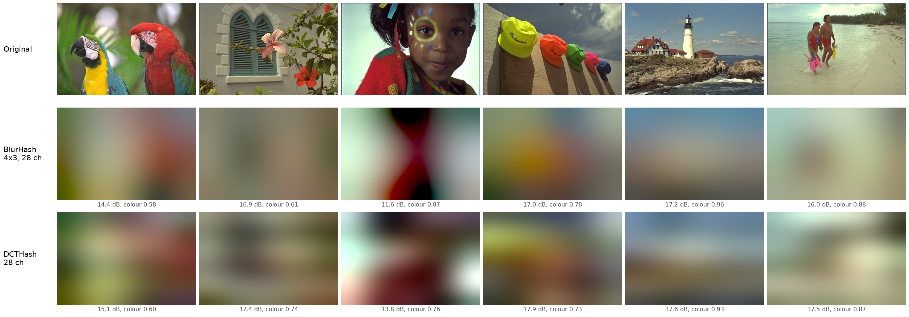
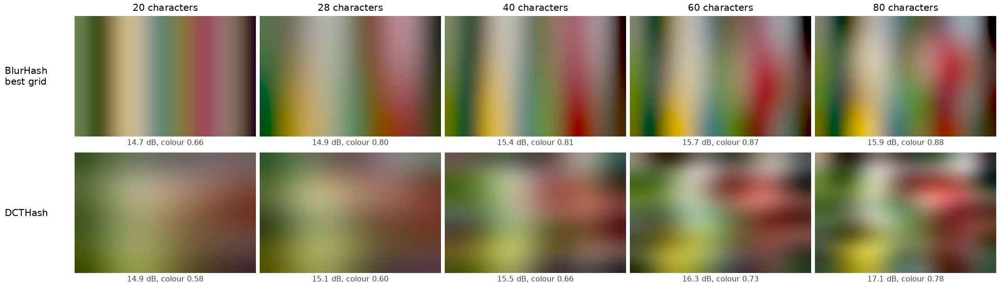
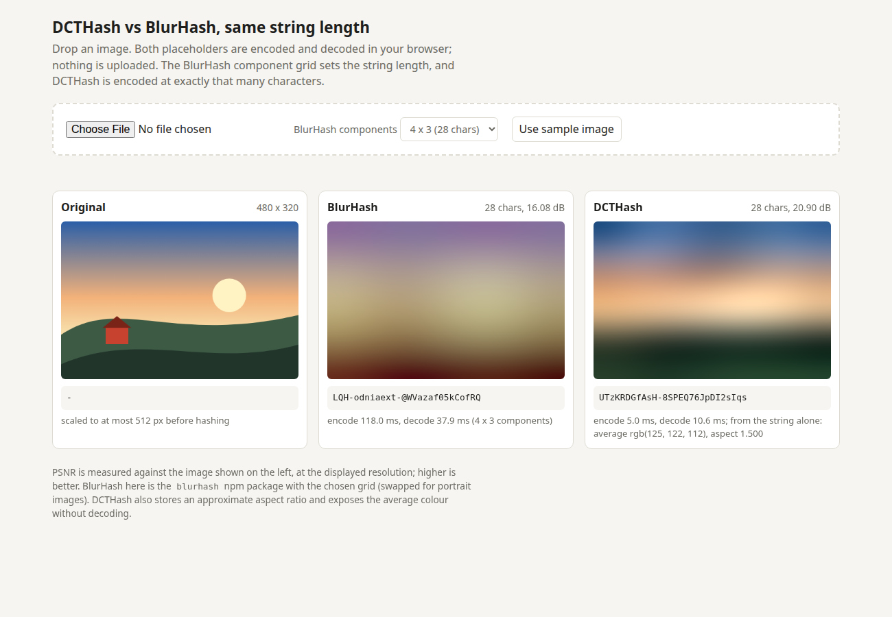
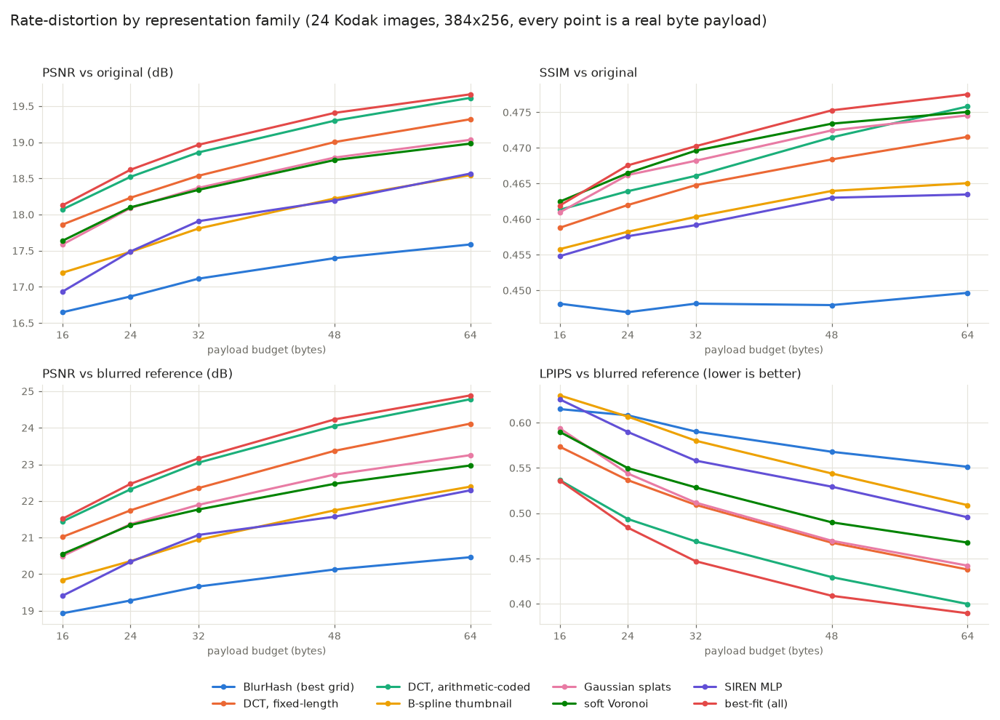
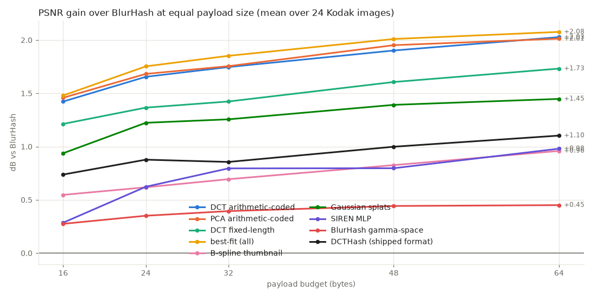
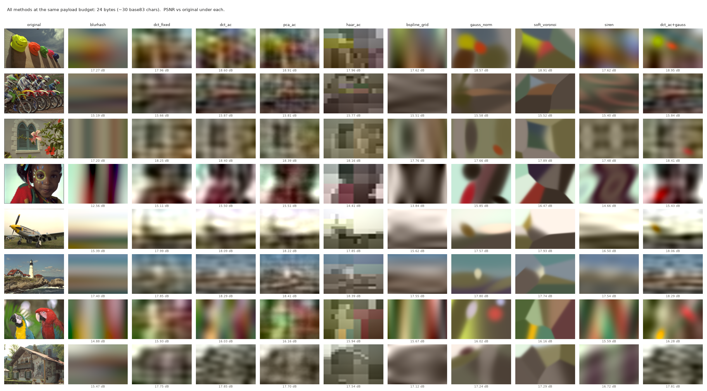

# DCTHash: a better BlurHash at the same string length

[BlurHash](https://github.com/woltapp/blurhash) turns an image into a 20-30 character string by
keeping a handful of low-frequency cosine (DCT) components. DCTHash keeps the same idea and the
same cosine basis but spends the bits differently (YCbCr, more and coarser coefficients in a
trained order), and preserves more of the image at the same string length.



*Six Kodak photos. Middle row: standard 4x3 BlurHash (28 characters). Bottom row: DCTHash at 28
characters. Captions: PSNR against the original (higher is better), and "colour" = colourfulness
of the placeholder relative to the original blurred to placeholder scale (1.00 = as colourful
as it should be). Regenerate with `python scripts/make_readme_figures.py`.*

What the picture shows: DCTHash places light, dark and colour regions more accurately (the
horizon, the red parrot on the right and the green one on the left, the mint background behind
the girl). BlurHash is a little more colourful on average, partly because its colour blobs are
exaggerated or misplaced. Neither can show a small object. An earlier version of the DCTHash
tables scored about 0.5 dB higher but looked grey and banded; see "Colour revision" below.

The same photo (the parrots) from 20 to 80 characters, with BlurHash given its best component
grid at each length:



| | DCTHash | BlurHash |
|---|---|---|
| Mean PSNR, 24 Kodak photos, 28 chars | 17.61 dB | 16.49 dB (4x3), 16.87 dB (best grid per image) |
| Mean PSNR, 80 chars | 18.64 dB | 17.59 dB (best grid per image) |
| Images where it wins on PSNR, of 24 | 22 at 20 chars, 24 at 28 to 80 chars | 2 at 20 chars, 0 at 28 to 80 |
| Chroma error at 28 chars (OKLab, lower is better) | 1.70 | 2.07 (4x3), 2.00 (best grid) |
| Colourfulness kept at 28 chars (1 = all) | 0.80 | 0.83 (4x3), 0.85 (best grid) |
| Saturation kept in the most saturated tenth, 28 chars | 0.68 | 0.63 (4x3), 0.66 (best grid) |
| Decode to 384x256 (Node 22) | 2.3 ms | 18.3 ms (`blurhash` 2.0.5) |
| Encode from 384x256 (Node 22) | 0.6 ms | 132 ms |
| String alphabet | base64url, 6 bits/char | base83, 6.375 bits/char |
| Valid lengths | any, 6 to 96 chars | set by the component grid |
| Extras readable from the string | average colour, approximate aspect ratio | average colour |

None of these numbers is a perceptual study: no user test was run on which placeholder people
prefer.

The demo page (`ts/demo/index.html`, opens from disk with no server) encodes any image you drop
with both, at the same string length:



This repository contains the frozen format (spec, TypeScript library, Python reference), and
below it the experiment that led to it: (a) a survey of candidate function families, (b) a
pipeline with a common codec interface that runs every candidate at equal byte budgets and can
pick the best one per image, and (c) measured results on the 24 Kodak photos.

## DCTHash: the production format

The experiment below picked `dct_fixed` as the best value. It is now frozen as a format with a
name, **DCTHash**, a Python reference and a TypeScript library.

```ts
import { encode, decode, averageColor, aspectRatio, isValid } from "dcthash";

const hash = encode(imageData.data, imageData.width, imageData.height);   // "UTzKRDGfAsH-8SPEQ76JpDI2sIqs"
const rgba = decode(hash, 32, 21);       // Uint8ClampedArray; draw small, let the browser scale it
averageColor(hash);                      // { r, g, b } without decoding pixels
aspectRatio(hash);                       // 1.5
```

```python
from hash2d import dcthash
s = dcthash.encode(rgba_uint8_array, length=28)
img = dcthash.decode(s, 384, 256)
```

- Spec: [`SPEC.md`](SPEC.md). Frozen integer tables: `format/tables.json`. Test vectors:
  `format/vectors.json`.
- TypeScript library, tests, benchmark and demo page: [`ts/`](ts/README.md).
- Python reference: `hash2d/dcthash.py` (numpy only).

### Format in one paragraph

A string of 6 to 96 characters from the base64url alphabet (`A-Z a-z 0-9 - _`; safe in URLs,
JSON and databases). Header: 1 version bit, 5 bits of aspect ratio (31 common ratios), 1 profile
bit, and in the photo profile a 2-bit contrast scale. The rest is quantised DCT coefficients of
a 32x32 YCbCr version of the image, in a trained order with a trained number of bits each (1 to
8). Any length works because the bit allocation is one nested sequence. Two table sets:
"photo" (trained on photographs, with chroma and low frequencies favoured) and "smooth" (for gradients and flat colours; full-range
quantisers with an exact zero). The encoder is integer-only, so every implementation produces
the same string; the decoder sums cosines directly at the requested size.

### Frozen format vs BlurHash at equal string length (24 Kodak images, 384x256)

| chars | method | PSNR | gain vs BlurHash (± s.e.m.) | wins | PSNR vs blurred | OKLab chroma error | colourfulness kept | top saturation kept |
|---|---|---|---|---|---|---|---|---|
| 20 | BlurHash, best grid | 16.65 | | | 18.93 | 2.07 | 0.79 | 0.62 |
| 20 | **DCTHash** | **17.30** | +0.65 ± 0.09 | 22/24 | 20.03 | 1.82 | 0.77 | 0.64 |
| 28 | BlurHash 4x3 | 16.49 | | | 18.68 | 2.07 | 0.83 | 0.63 |
| 28 | BlurHash, best grid | 16.87 | | | 19.28 | 2.00 | 0.85 | 0.66 |
| 28 | **DCTHash** | **17.61** | +0.74 ± 0.09 | 24/24 | 20.58 | 1.70 | 0.80 | 0.68 |
| 40 | BlurHash, best grid | 17.12 | | | 19.67 | 1.91 | 0.88 | 0.69 |
| 40 | **DCTHash** | **17.91** | +0.79 ± 0.09 | 24/24 | 21.14 | 1.54 | 0.85 | 0.73 |
| 60 | BlurHash, best grid | 17.40 | | | 20.14 | 1.83 | 0.94 | 0.75 |
| 60 | **DCTHash** | **18.30** | +0.90 ± 0.09 | 24/24 | 21.89 | 1.37 | 0.88 | 0.78 |
| 80 | BlurHash, best grid | 17.59 | | | 20.47 | 1.80 | 0.96 | 0.77 |
| 80 | **DCTHash** | **18.64** | +1.04 ± 0.10 | 24/24 | 22.59 | 1.23 | 0.92 | 0.82 |

Source: `results/frozen_tables.md` (`scripts/eval_frozen.py`), which also lists SSIM, overall
OKLab error and the initial tables. Gain and wins are against best-grid BlurHash; against the
4x3 BlurHash that people actually use, the gain at 28 characters is +1.12 dB. The colour
columns are defined in `hash2d/metrics.py: colour_metrics` and compare with the original
blurred at sigma = 8 px: mean OKLab chroma-plane distance x100 (lower is better),
Hasler-Suesstrunk colourfulness ratio, and mean OKLab chroma kept over the reference's most
saturated 10% of pixels (both 1.00 = all kept). DCTHash gets 6 bits per character and
BlurHash 6.375, and DCTHash spends 7 or 9 bits on its header.

### Colour revision (what changed after first publication)

The tables first published were trained to minimise RGB squared error. They scored 18.13 dB at
28 characters but looked grey-brown and banded on colourful photos. Measured causes
(`scripts/explore_colour.py`, on Kodak at 28 characters):

- **Too few chroma coefficients.** Only 9 of the 64 coded coefficients were chroma (24 of 159
  bits). 90% of the chroma error came from chroma coefficients that were never transmitted, 7%
  from quantisation and under 3% from clipping, so wider ranges or a chroma scale field could
  not have fixed it. Making every transmitted chroma coefficient exact left colourfulness at
  0.67; adding the 4x4 lowest chroma frequencies raised it to 0.84.
- **Banding was a choice of coefficients, not ringing.** Luma bits went to long runs of
  pure-vertical and pure-horizontal frequencies (up to about v = 10 with u = 0), which have the
  highest variance in photographs, while the mixed frequencies needed to localise them were
  not coded. The result is full-width stripes.

The fix changes only how the photo tables are trained (`scripts/train_frozen.py`): chroma
errors are weighted 8x, and every coefficient's weight is divided by
`(1 + (u^2 + v^2) / 9)^1.5`, which favours a compact, roughly isotropic low-pass set. At 28
characters 24 of 45 coded coefficients are now chroma. The bit stream layout is unchanged
except that chroma has its own list of loading factors.

| 28 chars, Kodak mean | PSNR | SSIM | PSNR vs blurred | OKLab chroma error | colourfulness kept | top saturation kept |
|---|---|---|---|---|---|---|
| BlurHash 4x3 | 16.49 | 0.442 | 18.68 | 2.07 | 0.83 | 0.63 |
| DCTHash, initial tables | 18.13 | 0.462 | 21.57 | 2.12 | 0.68 | 0.54 |
| DCTHash, now | 17.61 | 0.459 | 20.58 | 1.70 | 0.80 | 0.68 |

The cost is 0.46 to 0.64 dB of PSNR depending on length (0.52 dB at 28 characters).

How it looks, judged on the sheets in `results/colour/` (all 24 Kodak images at 28 and 40
characters: original, BlurHash, initial tables, now):

- Clearly better than the initial tables on colourful photos: the parrots, the girl in the red
  sweater, the caps, the raft, the red barn, the boat on teal water. Stripes are gone or much
  weaker on all of them.
- Softer than the initial tables on near-neutral photos (the sailing boats, the aeroplane, the
  painted house, the beach): some luma structure was traded away and there was little colour
  to gain.
- Against BlurHash 4x3: colour regions are in the right places and the picture has more
  structure, but BlurHash is still slightly more saturated on a few images (the caps, the
  girl), and small saturated objects (the hibiscus flower, the swimsuits) are lost by both.
- A bright halo from luma overshoot remains on the girl photo.

Guarding against overfitting: the tables are trained on Picsum only, but the three numbers
(8, 9 and 1.5) were picked by eye on Kodak sheets from about twenty settings, so Kodak is no
longer a clean test set for them. On eight scikit-image sample photos that are in neither set
(`results/colour/holdout.md`) the pattern is the same at 28 characters: PSNR 17.92 -> 17.59
(BlurHash best grid 16.77), chroma error 2.37 -> 1.72 (BlurHash 1.98), colourfulness
0.66 -> 0.78 (BlurHash 0.81), top saturation 0.63 -> 0.75 (BlurHash 0.72). A milder setting
(chroma x4, exponent 1) costs only 0.3 dB but keeps visible banding.

Tried and not adopted: a separate chroma scale field (lower chroma error by 3%, no visible
difference, 2 header bits); quantisers with an exact zero level in the photo profile (slightly
calmer, 0.05 dB worse, no clear visual gain); a decoder-side high-frequency taper (no visible
effect on the banding). The initial tables are kept as `format/tables_v0_initial.json` for
comparison only.

On non-photographic content (measured on six synthetic images, not a dataset), at 28 chars:

| image | BlurHash 4x3 | DCTHash | profile chosen |
|---|---|---|---|
| two-axis colour gradient (red across, blue down) | 31.9 dB | 34.2 dB | smooth |
| RGB ramp with a sawtooth channel | 17.2 dB | 18.1 dB | smooth |
| solid teal | 43.6 dB | 46.9 dB | smooth |
| solid white | 41.3 dB | 48.1 dB | smooth |
| low-contrast grey wave | 39.7 dB | 40.0 dB | smooth |
| flat shapes with hard edges | 10.8 dB | 12.3 dB | photo |

Before the smooth profile was added, the photo tables alone scored 17.7 dB on the first row
and 33 dB on solid white. All changes made while freezing are listed in `SPEC.md` section 9.
These were re-checked after the colour revision (`results/colour/synthetic.md`); solid black,
white, red and grey still decode to within 1 level of the right average colour.

### TypeScript library: size and speed

| | DCTHash | `blurhash` 2.0.5 (4x3) |
|---|---|---|
| decoder bundle, minified / gzip | 7.1 kB / 3.9 kB | - |
| full library, minified / gzip | 10.2 kB / 5.3 kB | - |
| decode to 32x21 | 0.03 ms | 0.13 ms |
| decode to 384x256 | 2.3 ms | 18.3 ms |
| encode from 384x256 | 0.6 ms | 132 ms |

Node 22, one machine, warm (`results/ts_bench.md`); not measured in browsers or on phones.
About half of the decoder bundle is the tables.

### Verification that was run

- `npm test` in `ts/`: 14 tests pass. TypeScript `encode` reproduces all 240 reference strings
  (24 images x 10 lengths, both profiles, alpha, 1x1 to 384x256) exactly. TypeScript `decode`
  matches the Python reference on 148 decodes with a maximum difference of 0 (the stated
  tolerance is 1). Helpers match. Wrong lengths, every non-alphabet character, a set version
  bit, non-strings, bad sizes and bad encoder arguments all raise `DCTHashError`; 3000 random
  well-formed strings decode and 3000 random garbage strings are handled without a crash.
- `python -m tests.test_dcthash`: the Python reference reproduces the committed vectors and
  rejects the same malformed input.
- `scripts/train_frozen.py` re-run reproduces `format/tables.json` byte for byte (from the
  cached coefficient analysis in `data/`).
- All of the above was re-run after the colour revision, with regenerated vectors.
- The demo page was rendered from `file://` in headless Chrome and showed all three images and
  both strings for the built-in sample. Dropping a file was not exercised automatically.

### Limits and decisions worth revisiting

- **No alpha.** Transparent pixels are composited over white.
- **The photo tables are tuned for look, not PSNR.** The chroma weight (8x) and the
  low-frequency prior cost about 0.5 dB and were chosen by eye on Kodak; no perceptual study
  was done. Small saturated objects are still lost, as in BlurHash.
- **Aspect ratio** is one of 31 exact common ratios. Unusual ratios are off by up to 9.5%
  (15.5% beyond 3:1). A uniform log scale would be within 4.4% everywhere but exact nowhere.
- **Base64url instead of base83** costs 6% of the bits per character in exchange for URL
  safety and no big-integer arithmetic.
- **Maximum length 96, minimum 6.** One version bit.
- **Smooth profile** was trained on procedurally generated gradients, and checked on only six
  hand-made images.
- **Hard-edged graphics** (logos, screenshots) are poor at this size in any format.
- The training set is still 993 photos; the test set is still 24 Kodak images.

### Reproduce the frozen format

```bash
.venv/bin/python scripts/train_frozen.py      # -> format/tables.json (deterministic)
.venv/bin/python scripts/make_vectors.py      # -> format/vectors.json
.venv/bin/python -m tests.test_dcthash
.venv/bin/python scripts/eval_frozen.py       # -> results/frozen_tables.md, results/frozen_eval.csv
.venv/bin/python scripts/explore_colour.py sheets     # -> results/colour/kodak_{28,40}ch_{1,2,3}.png
.venv/bin/python scripts/explore_colour.py holdout    # -> results/colour/holdout.md, holdout_28ch.png
.venv/bin/python scripts/explore_colour.py synthetic  # -> results/colour/synthetic.md
.venv/bin/python scripts/make_readme_figures.py       # -> docs/comparison_28.png, docs/lengths.png
cd ts && npm install && npm test && npm run bench
# demo: open ts/demo/index.html in a browser (after npm run build / npm test)
```

Node 22 and npm 10 were used. Dev dependencies: `typescript`, `esbuild`, `@types/node`, and
`blurhash` (only for the demo and the benchmark). The library itself has none.

---

# The experiment behind it

## Headline result

| budget | BlurHash (best grid) | best practical codec (`dct_ac`) | gain | best of everything (`bestfit_all`) |
|---|---|---|---|---|
| 16 B (~20 chars) | 16.65 dB | 18.07 dB | **+1.42 dB** | 18.13 dB (+1.48) |
| 24 B (~30 chars) | 16.87 dB | 18.52 dB | **+1.65 dB** | 18.62 dB (+1.75) |
| 32 B (~40 chars) | 17.11 dB | 18.86 dB | **+1.75 dB** | 18.97 dB (+1.85) |
| 48 B (~60 chars) | 17.40 dB | 19.30 dB | **+1.90 dB** | 19.41 dB (+2.01) |
| 64 B (~80 chars) | 17.59 dB | 19.61 dB | **+2.03 dB** | 19.66 dB (+2.08) |

Mean PSNR over 24 Kodak images at 384x256. Every number comes from a real serialized payload of
at most that many bytes. The gain holds on 24/24 images at every budget (paired s.e.m. about
0.14 dB).

- **The winner is not a new function family. It is still cosines.** What wins is spending the
  bits better: YCbCr with few chroma coefficients, many coarsely quantized coefficients instead
  of few precise ones, a trained prior, and entropy coding.
- Put the other way round: the fixed-length DCT codec at **6 bytes** (16.89 dB) matches BlurHash
  at **24 bytes** (16.87 dB), and the entropy-coded DCT at 10 bytes matches BlurHash at 64 bytes.
- A learned PCA/KLT basis is only 0.00 to 0.05 dB better than DCT. Not worth a 330 KiB table.
- Adaptive primitives (Gaussian splats, soft Voronoi cells) beat BlurHash by 0.9 to 1.4 dB but
  lose to the DCT codecs by 0.4 to 0.6 dB in PSNR, and need a multi-second iterative encoder.
  They do look different (clean shapes instead of ringing) and score best on SSIM/LPIPS against
  the unblurred original.
- Tiny neural nets (SIREN) and the "tiny thumbnail + smooth upscale" approach are the weakest
  alternatives (+0.3 to +1.0 dB).
- Per-image best-fit selection adds only 0.02 to 0.11 dB over the best single codec.

The scale matters when reading these numbers: in this regime everything lives between 16.5 dB
(8 float coefficients) and 20.2 dB (320 float coefficients); see "How much room is there".
A 1.5 to 2 dB gain is the difference between about 16 and about 100 unquantized DCT coefficients.





Visual comparison at 24 bytes (more in `results/grid_16B.png`, `grid_32B.png`, `grid_64B.png`,
`grid_32B_portrait.png`):



## Recommendation

1. **Default choice: `dct_ac`** (DCT in YCbCr, trained ordering and Laplacian priors, arithmetic
   coded). +1.4 to +2.0 dB over BlurHash at every budget, encodes in about 20 ms in unoptimized
   Python, and the decoder is a range decoder plus a sum of cosines on a 32x32 canvas plus an
   upscale. Decoder tables: about 4 KiB (a mean image and one scale per coefficient).
2. **If you want no entropy coder and a fixed-length string: `dct_fixed`.** +1.2 to +1.7 dB, a
   1 ms encoder, a trivially simple decoder (read fixed bit fields, sum cosines). This keeps about
   85% of the gain for a fraction of the complexity and is the best value in the table.
3. **If the goal is a shorter string at BlurHash quality:** `dct_fixed` at 6 to 13 bytes
   (8 to 17 base83 chars) matches BlurHash at 24 to 64 bytes.
4. **Not recommended:** PCA (table cost, no gain), Haar (blocky), Legendre (slightly worse than
   DCT everywhere), B-spline thumbnail, SIREN, and the DCT+Gaussian hybrid (no gain over plain
   DCT for a 100x slower encoder).
5. **Worth a look only for aesthetics:** `gauss_norm` / `soft_voronoi`. They give a "low-poly /
   soft blobs" look with real edges, which some people may prefer to DCT ringing, at a PSNR cost
   and with a slow encoder. This is a subjective judgement from looking at the grids; no user
   study was run.

## Fairness rules used

- Every method implements `encode(image, budget_bytes) -> bytes` and
  `decode(payload, w, h) -> image`; the runner asserts `len(payload) <= budget` and computes
  metrics only on `decode(payload)`. No float coefficients are ever compared.
  `scripts/make_report.py` re-decodes the stored payloads in a fresh process and asserts that
  the PSNR matches the recorded one.
- BlurHash is re-implemented faithfully; `tests/test_blurhash.py` checks that it produces
  strings identical to the `blurhash` pip package. A base83 string of N chars is counted as
  `ceil(N * log2(83) / 8)` bytes (it is serialized as the integer it represents, and round-trips).
  So 16 / 24 / 32 / 48 / 64 bytes correspond to 20 / 30 / 40 / 60 / 80 chars. The standard 4x3
  BlurHash (28 chars) is 23 bytes.
- BlurHash gets its **best** component grid per image: for each budget every maximal `(nx, ny)`
  that fits is tried and the lowest-MSE one is kept. `blurhash_default` (grid chosen from aspect
  ratio only) is 0.2 to 0.6 dB worse and is reported separately. Note that the PSNR-optimal grid
  is often lopsided (for example 6x2), which looks stripy; see the grids.
- Trained tables (mean image, coefficient order, Laplacian scales, quantizer ranges, PCA basis)
  are learned from **993 Lorem Picsum (Unsplash) photos, disjoint from the Kodak test set**, and
  are part of the decoder. They live in `models/transform_tables.npz`.
- The decoder is given `(w, h)` (as in BlurHash) and the transform codecs use the aspect class
  (landscape / portrait / square) to select a table set. This costs no payload bits.
- Method tags, headers and padding all count toward the budget. Some codecs cannot use every
  byte (splats come in 4-byte units, SIREN in whole architectures); the "bytes used" column in
  `results/tables.md` shows this. `siren` in particular often leaves bytes unused.
- Metrics are computed in sRGB on 8-bit-rounded output. BlurHash fits in linear light, which
  costs it 0.3 to 0.45 dB of sRGB PSNR (`blurhash_gamma` ablation). That is a design choice of
  BlurHash rather than a flaw, and it explains only a fifth of the gap.

## Exploration: which function families suit a 16-64 byte budget?

A budget of 128 to 512 bits is tiny. Three things decide the outcome, in this order:

1. **How many bits each degree of freedom costs.** A fixed basis (DCT, PCA, polynomials) pays
   only for amplitudes: 1 to 6 bits per coefficient. An adaptive primitive (a Gaussian, a Voronoi
   site, a mesh vertex) must also pay for *where it is* and *what shape it has*: 23 to 32 bits
   each. At 24 bytes that is about 70 coarse DCT coefficients versus 5 to 8 primitives.
2. **How the bits are spread.** Natural-image energy falls off steeply with frequency and chroma
   carries far less than luma. Giving every component the same precision in R, G and B (what
   BlurHash does) wastes most of the budget.
3. **The prior.** Whatever the decoder already knows (mean image, typical coefficient
   magnitudes) is free.

| family | status | reasoning | measured outcome |
|---|---|---|---|
| BlurHash (linear RGB DCT, 19 levels/channel) | baseline | reference | 16.65 to 17.59 dB |
| DCT in YCbCr, trained order and bit allocation, fixed length (`dct_fixed`) | implemented | same basis, better bit spending (ThumbHash goes part of this way) | +1.2 to +1.7 dB |
| + arithmetic coding with Laplacian priors (`dct_ac`) | implemented | lets the *image* decide which coefficients get bits | +1.4 to +2.0 dB |
| PCA / KLT learned basis (`pca_fixed`, `pca_ac`) | implemented | optimal linear basis; but the KLT of natural images is known to be close to the DCT | +0.00 to +0.05 dB over DCT: confirmed not worth it |
| Legendre polynomials (`legendre_ac`) | implemented | same span as low-order DCT at low degree, worse conditioning at edges | 0.2 to 0.5 dB below DCT |
| Haar wavelets (`haar_ac`) | implemented | localized, but discontinuous; a smooth wavelet would need a bigger decoder | 0.3 dB below DCT in PSNR, visibly blocky, worst SSIM-vs-blurred |
| Tiny thumbnail + cubic B-spline upscale, LSQ-fitted (`bspline_grid`) | implemented | spatial samples all cost the same bits; no energy compaction | only +0.55 to +0.96 dB |
| Anisotropic Gaussian splats, additive (`gauss_add`) or normalized (`gauss_norm`) | implemented | adaptive, can place detail where it matters, but 32 bits each | +0.9 to +1.45 dB |
| Soft Voronoi + palette (`soft_voronoi`) | implemented | cheapest primitive (23 bits) that produces real edges | +1.0 to +1.4 dB |
| SIREN / CPPN with 6-bit weights (`siren`) | implemented | 1 hidden layer = sum of free plane waves; weights are a poor code | +0.3 to +1.0 dB |
| DCT base + residual Gaussians (`dct_ac+gauss`) | implemented | spend some bytes on localized detail | +0.00 dB over `dct_ac`; the encoder picks k=0 most of the time |
| Per-image best method (`bestfit_fast`, `bestfit_all`) | implemented | 1-byte tag inside the budget | +0.02 to +0.11 dB over best single |
| Radial basis functions | folded in | isotropic Gaussians are a special case of `gauss_add` | - |
| Adaptive triangle / gradient meshes | not implemented | each vertex costs position + colour (about 23 bits), the same economics as Voronoi sites; a *regular* mesh is `bspline_grid` | reasoned only |
| Smooth wavelets (CDF 5/3, 9/7) | not implemented | would fix Haar blockiness; expected to land near DCT since at these sizes only the coarsest 2 to 3 levels are ever coded | reasoned only |
| Learned non-linear decoder (small autoencoder) | not implemented | probably the only thing with real headroom over DCT, but needs a far larger training set than 1000 images and a neural decoder in the client | reasoned only |
| Vector quantization / learned dictionary | not implemented | at 128+ bits a codebook would need product structure, which leads back to transform coding | reasoned only |
| Edge / contour primitives | not implemented | an edge costs at least as much as a splat | reasoned only |

### Why the DCT codecs win: where BlurHash loses its bits

BlurHash 4x3 stores 12 components, each as an (R, G, B) triple at about 4.25 bits per number:
36 numbers. In YCbCr terms two thirds of those numbers are chroma, which carries little energy.
The trained ordering puts only 4 to 6 chroma coefficients in the top 32.

`dct_fixed` at the same 24 bytes instead codes **77 coefficients**: the first few at 5 to 6 bits,
and 45 of them at only 1 or 2 bits each. A 1-bit coefficient is just a sign with a trained magnitude,
and it turns out that many sign-only coefficients are worth more than a few precise ones.

Ablation ladder at 24 bytes (mean PSNR):

| step | PSNR |
|---|---|
| BlurHash, grid from aspect ratio (`blurhash_default`) | 16.50 |
| BlurHash, best grid per image (`blurhash`) | 16.87 |
| same, DCT in gamma space (`blurhash_gamma`) | 17.22 |
| YCbCr + mean image + trained order + trained bit allocation (`dct_fixed`) | 18.23 |
| + arithmetic coding, image-adaptive (`dct_ac`) | 18.52 |
| DCT replaced by learned PCA (`pca_ac`) | 18.55 |
| per-image best of all methods (`bestfit_all`) | 18.62 |

### How much room is there?

`scripts/ceiling.py` reconstructs from **unquantized float** coefficients (not a codec, context
only), K coefficients in trained order:

| basis | K=8 | K=16 | K=24 | K=36 | K=48 | K=64 | K=96 | K=160 | K=320 |
|---|---|---|---|---|---|---|---|---|---|
| dct | 16.52 | 17.14 | 17.49 | 17.87 | 18.14 | 18.43 | 18.86 | 19.46 | 20.23 |
| pca | 16.51 | 17.16 | 17.53 | 17.91 | 18.21 | 18.50 | 18.94 | 19.51 | 20.13 |
| legendre | 16.54 | 17.02 | 17.40 | 17.71 | 17.97 | 18.20 | 18.60 | 19.07 | 19.48 |
| haar | 16.20 | 16.76 | 17.03 | 17.32 | 17.70 | 17.97 | 18.31 | 18.86 | 19.72 |

The full 32x32 canonical grid, unquantized, gives 22.14 dB.

Two things follow. First, PSNR against a sharp 384x256 original is dominated by detail that no
placeholder can reach, so all differences look small in dB. Second, `dct_ac` at 24 bytes
(18.52 dB) beats 64 *float* coefficients in fixed order (18.43 dB), because entropy coding lets
each image spend its bits on its own significant coefficients.

## Methods in detail

All transform codecs work on a canonical 32x32 grid of the normalized image square, in
gamma-space YCbCr, after subtracting a trained mean image; the decoder upsamples with
Catmull-Rom. Code: `hash2d/codecs/transform.py`.

- **`*_fixed`**: no header. The bit allocation for a given payload length is derived greedily
  from trained distortion tables; each coefficient gets a uniform quantizer with a trained clip
  range. Payload layout is a pure function of its length.
- **`*_ac`**: 1 header byte (6 bits: global step size on a log scale; 2 bits: number of coded
  coefficients, 40/80/160/320), then a static arithmetic code of uniformly quantized
  coefficients under per-coefficient Laplacian priors. The encoder binary-searches the finest
  step that fits and tries three dead-zone offsets. Reconstruction uses the Laplacian centroid.
  The Python implementation uses exact big-integer arithmetic coding; a production decoder
  would use a standard 32-bit range coder and integer frequency tables (the tables here are
  computed with floating-point `exp`, which is not bit-reproducible across platforms as is).
- **`bspline_grid`** (`bspline.py`): 1 header byte for the luma grid size; 5-bit luma control
  points and 4-bit chroma control points on a coarser grid; least-squares fit of the control
  points; the encoder searches all grid shapes.
- **`gauss_add`, `gauss_norm`, `soft_voronoi`** (`splat.py`): parameters are fitted with Adam
  (32 random restarts in one batch, 500 float steps then 400 steps with straight-through
  quantization) on a 96 px thumbnail. Splat = 32 bits (x5 y5, two log-sigmas 3+3, angle 3,
  colour 5+4+4); Voronoi site = 23 bits plus one global sharpness byte.
- **`siren`** (`siren.py`): sine MLP with 1 or 2 hidden layers, weights at 6 bits with
  quantization-aware training, 1 header byte for the architecture.
- **`dct_ac+gauss`**, **`bestfit_*`** (`hybrid.py`): header byte = number of residual splats,
  or the method tag. `bestfit_fast` chooses among closed-form encoders only (dct_ac, pca_ac,
  haar_ac, legendre_ac, bspline_grid, blurhash); `bestfit_all` adds the fitted ones.

What best-fit actually picks (counts over 24 images) is in `results/tables.md`. At 32 bytes
`bestfit_all` picks pca_ac 9, dct_ac 7, dct_ac+gauss 2, haar_ac 2, and gauss_add, gauss_norm,
soft_voronoi, legendre_ac once each. Primitive-based methods win on 1 to 4 of the 24 images
per budget, and it is mostly the same few images: the red door (kodim02), the girl with face
paint (kodim15) and the parrots (kodim23), all dominated by a few large flat-coloured regions.
The hybrid's encoder chooses k = 0 (no splats) on 17 to 20 of 24 images at every budget.

## Results

Full per-budget tables with all metrics are in [`results/tables.md`](results/tables.md); raw
rows in `results/results.csv` (17 methods x 24 images x 5 budgets) and
`results/results_small.csv` (6 to 12 byte budgets for four fast codecs).

### Mean PSNR (dB) vs original

| method | 16 B | 24 B | 32 B | 48 B | 64 B |
|---|---|---|---|---|---|
| bestfit_all | 18.13 | 18.62 | 18.97 | 19.41 | 19.66 |
| bestfit_fast | 18.10 | 18.55 | 18.89 | 19.35 | 19.65 |
| pca_ac | 18.11 | 18.55 | 18.87 | 19.35 | 19.60 |
| dct_ac | 18.07 | 18.52 | 18.86 | 19.30 | 19.61 |
| dct_ac+gauss | 18.05 | 18.52 | 18.86 | 19.31 | 19.62 |
| pca_fixed | 17.92 | 18.35 | 18.65 | 19.09 | 19.40 |
| legendre_ac | 17.89 | 18.30 | 18.55 | 18.89 | 19.09 |
| dct_fixed | 17.86 | 18.23 | 18.54 | 19.00 | 19.32 |
| haar_ac | 17.77 | 18.22 | 18.53 | 18.96 | 19.26 |
| gauss_norm | 17.59 | 18.09 | 18.37 | 18.79 | 19.03 |
| gauss_add | 17.60 | 18.13 | 18.35 | 18.70 | 18.91 |
| soft_voronoi | 17.64 | 18.10 | 18.34 | 18.75 | 18.98 |
| siren | 16.93 | 17.49 | 17.91 | 18.19 | 18.57 |
| bspline_grid | 17.20 | 17.49 | 17.81 | 18.22 | 18.55 |
| blurhash_gamma | 16.92 | 17.22 | 17.51 | 17.84 | 18.04 |
| **blurhash** | 16.65 | 16.87 | 17.11 | 17.40 | 17.59 |
| blurhash_default | 16.05 | 16.50 | 16.80 | 17.17 | 17.37 |

### PSNR gain over BlurHash (dB), paired over images

| method | 16 B | 24 B | 32 B | 48 B | 64 B |
|---|---|---|---|---|---|
| bestfit_all | +1.48 | +1.75 | +1.85 | +2.01 | +2.08 |
| pca_ac | +1.46 | +1.68 | +1.75 | +1.95 | +2.01 |
| dct_ac | +1.42 | +1.65 | +1.75 | +1.90 | +2.03 |
| dct_fixed | +1.21 | +1.37 | +1.42 | +1.61 | +1.73 |
| haar_ac | +1.12 | +1.35 | +1.42 | +1.56 | +1.67 |
| gauss_norm | +0.94 | +1.22 | +1.26 | +1.39 | +1.45 |
| soft_voronoi | +0.99 | +1.23 | +1.23 | +1.36 | +1.39 |
| siren | +0.29 | +0.62 | +0.80 | +0.80 | +0.98 |
| bspline_grid | +0.55 | +0.62 | +0.69 | +0.83 | +0.96 |

Standard error of these paired differences is 0.06 to 0.17 dB; all listed methods beat BlurHash
on at least 22 of 24 images at every budget.

### PSNR vs a slightly blurred reference (Gaussian sigma = 4 px, about 1% of the width)

Placeholders are not expected to hold high frequencies, so this is the more relevant fidelity
number. The ranking is unchanged and the gaps are larger:

| method | 16 B | 24 B | 32 B | 48 B | 64 B |
|---|---|---|---|---|---|
| bestfit_all | 21.52 | 22.47 | 23.17 | 24.23 | 24.89 |
| pca_ac | 21.50 | 22.38 | 23.06 | 24.20 | 24.85 |
| dct_ac | 21.44 | 22.32 | 23.05 | 24.05 | 24.78 |
| dct_fixed | 21.02 | 21.74 | 22.35 | 23.37 | 24.11 |
| haar_ac | 20.80 | 21.62 | 22.23 | 23.14 | 23.80 |
| gauss_norm | 20.50 | 21.37 | 21.89 | 22.72 | 23.25 |
| soft_voronoi | 20.55 | 21.34 | 21.77 | 22.47 | 22.97 |
| bspline_grid | 19.84 | 20.36 | 20.94 | 21.74 | 22.39 |
| siren | 19.41 | 20.34 | 21.07 | 21.57 | 22.29 |
| **blurhash** | 18.93 | 19.28 | 19.66 | 20.13 | 20.46 |

`dct_ac` is +2.5 dB (16 B) to +4.3 dB (64 B) over BlurHash on this metric.

### Other metrics, honestly

- **SSIM vs original** barely moves (0.448 to 0.478 across everything) because none of these
  images contain the original's fine structure. On it, `soft_voronoi` and `gauss_norm` are level
  with or slightly ahead of `dct_ac` at 16 to 48 bytes (for example 0.470 vs 0.466 at 32 B).
- **MS-SSIM** agrees with PSNR: `dct_ac` 0.450 to 0.562, BlurHash 0.367 to 0.420.
- **LPIPS vs original is not usable here.** It scores every method between 0.79 and 0.95 (very
  bad) and *prefers BlurHash to the DCT codecs* (0.87 vs 0.94), and prefers `soft_voronoi` most
  (0.79 to 0.87). It appears to reward smooth or flat output and punish low-amplitude ringing.
  Against the blurred reference LPIPS agrees with PSNR (`pca_ac` 0.52 to 0.39, `dct_ac` 0.54 to
  0.40, BlurHash 0.62 to 0.55). Take this as a caution that "perceptual" quality at this size is
  not settled by these metrics; the DCT codecs do show visible plaid-like ringing in the grids.

### Bytes needed to match BlurHash's mean PSNR

| method | BlurHash@16 B | @24 B | @32 B | @48 B | @64 B |
|---|---|---|---|---|---|
| dct_fixed | < 6 | < 6 | 8 | 10 | 13 |
| dct_ac | < 6 | < 6 | 7 | 9 | 10 |
| pca_ac | < 6 | < 6 | 7 | 8 | 10 |
| gauss_norm | < 16 | < 16 | < 16 | < 16 | 16 |
| bspline_grid | < 16 | < 16 | < 16 | 22 | 27 |

Interpolated on mean rate-distortion curves; "< 6" means already better at the smallest budget
tested for that codec.

### Cost: encode time, decode time, decoder complexity

Single-process timings at 32 bytes (`results/timing.md`; median of 4 images; unoptimized
numpy decoders; fitted encoders on an RTX PRO 6000 that was shared with another job, so treat
the multi-second figures as rough). The encode column in `results/tables.md` was measured with
6 parallel workers and is inflated for the fitted methods.

| method | encode | decode 384x256 | decode 32 px | decoder tables | JS / mobile client |
|---|---|---|---|---|---|
| blurhash | 5 ms | 2.4 ms | 0.16 ms | none | reference |
| dct_fixed | 1 ms | 1.9 ms | 1.6 ms | ~9 KiB | easy: bit fields + cosines |
| dct_ac | 20 ms | 2.0 ms | 1.65 ms | ~4 KiB | easy: adds a ~40-line range decoder |
| pca_fixed / pca_ac | 1 / 23 ms | 2.0 / 2.6 ms | 1.6 / 2.2 ms | ~330 KiB per aspect class at 8 bit | works, but the table is far larger than the decoder |
| legendre_ac, haar_ac | 22-27 ms | 1.5-2.1 ms | 1.2-1.7 ms | ~4 KiB | easy |
| bspline_grid | 52 ms | 10 ms | 0.27 ms | none | simplest of all (it is a texture upscale) |
| gauss_add / gauss_norm / soft_voronoi | 1.0-1.3 s (GPU) | 7-9 ms | 0.12-0.15 ms | none | decoder easy (n exps per pixel); **encoder impractical on a client**, fine on a server |
| siren | 2.3 s (GPU) | 5.5 ms | 0.12 ms | none | same as above |
| dct_ac+gauss | 2.2 s (GPU) | 3.7 ms | 1.5 ms | ~4 KiB | not worth it |
| bestfit_fast | ~0.1 s | 2.1 ms | 1.7 ms | union | only if PCA table is acceptable |
| bestfit_all | ~8 s (GPU) | 2.6 ms | 1.7 ms | union | not worth it |

Notes. The transform decoders' ~1.6 ms is a Python loop over up to 320 basis functions and does
not depend on output size; a real decoder would use a separable inverse DCT (a 32x32 IDCT is
microseconds) and let the GPU upscale. No fitted encoder needs minutes per image; they need 1 to
2 seconds on a GPU and were not measured on CPU.

## Caveats

- **24 test images, one dataset** (Kodak, downscaled 2x to 384x256 or 256x384, 6 of them
  portrait). The effect sizes are large relative to the paired standard errors, but Kodak is
  not a sample of what apps show (no screenshots, illustrations, faces-only crops, UI).
- The training set is small (993 photos, 7944 crops per aspect class). PCA would improve
  slightly with more data, but the DCT ceiling table suggests the headroom is about 0.05 dB.
- PSNR/SSIM/LPIPS are weak proxies for "is this a nice placeholder". The DCT codecs' ringing
  and BlurHash's stripes under best-grid search are both visible; no perceptual study was run.
- BlurHash strings are also URL-safe text. All codecs here emit bytes; base83-encoding a
  B-byte payload gives `ceil(8B / 6.375)` chars (16 B -> 21 chars, one more than the 20-char
  BlurHash it is compared with: a 0.5-bit rounding difference).
- `*_ac` frequency tables are computed with floating point at decode time. A deployable format
  must freeze them as integers.
- The hybrid tried only one residual primitive (additive Gaussians) and three values of k.
- Smooth wavelets, adaptive meshes, VQ and a learned non-linear decoder were reasoned about but
  not run (see the exploration table).
- Alpha channels (which ThumbHash supports) are out of scope.

## Reproduce

```bash
uv venv .venv --python 3.12 && uv pip install --python .venv/bin/python -r requirements.txt
.venv/bin/python scripts/download_data.py     # Kodak (test, 24) + Picsum (train, ~1000); ~50 MB
.venv/bin/python scripts/train_bases.py       # -> models/transform_tables.npz (~40 s; already included)
.venv/bin/python -m tests.test_blurhash       # our BlurHash == pip blurhash
.venv/bin/python -m tests.test_roundtrip      # budgets respected, deterministic decode
.venv/bin/python scripts/run_eval.py --workers 6            # ~30 min with a GPU; payloads cached in results/payloads/
.venv/bin/python scripts/run_eval.py --budgets 6 8 10 12 --methods blurhash dct_fixed dct_ac pca_ac --out results/results_small.csv
.venv/bin/python scripts/time_codecs.py       # -> results/timing.md
.venv/bin/python scripts/ceiling.py           # -> results/ceiling.md
.venv/bin/python scripts/make_report.py       # -> results/tables.md, rd_*.png, grid_*.png
```

Without network access `run_eval.py` falls back to four scikit-image sample photos (the trained
tables are shipped, so training data is not needed to evaluate).

Using a codec directly:

```python
import numpy as np
from PIL import Image
from hash2d.codecs.transform import TransformCodec

img = np.asarray(Image.open("photo.jpg").convert("RGB"), dtype=np.float32) / 255
codec = TransformCodec("dct", "ac")          # or ("dct", "fixed")
payload = codec.encode(img, 24)              # bytes, len <= 24
preview = codec.decode(payload, 384, 256)    # float RGB in [0, 1]
```

## Layout

```
hash2d/common.py            colour, resampling matrices, bit I/O, Codec base class
hash2d/bases.py             analytic DCT / Legendre / Haar bases on the 32x32 grid
hash2d/codecs/blurhash_ref.py   faithful BlurHash + byte serialization + grid search
hash2d/codecs/transform.py      dct/pca/legendre/haar x fixed/arithmetic-coded
hash2d/codecs/bspline.py        thumbnail control grid
hash2d/codecs/splat.py          Gaussian splats, soft Voronoi (torch fit, numpy decode)
hash2d/codecs/siren.py          quantized sine MLP
hash2d/codecs/hybrid.py         DCT + residual splats, per-image best-fit
hash2d/dcthash.py           DCTHash reference implementation (frozen format)
hash2d/registry.py          the list of codecs under test
hash2d/metrics.py           PSNR, SSIM, MS-SSIM, LPIPS, blurred-reference variants
scripts/                    download, train, evaluate, time, report
models/transform_tables.npz trained decoder tables of the experiment (Picsum only)
SPEC.md                     DCTHash format specification
format/tables.json          frozen integer tables;  format/vectors.json  cross-implementation test vectors
ts/                         TypeScript library, tests, benchmark, demo page
results/                    csv, tables, plots, grids, cached payloads
```
